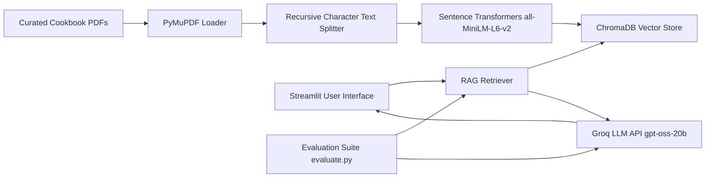

# 🍳 RAG-Based Cooking Assistant Chatbot

---

# Project Overview

This project demonstrates an intelligent, code-transparent **Retrieval-Augmented Generation (RAG)** conversational AI application built using **Python, Streamlit, and LangChain**. The solution simulates a production-ready assistant that allows users to ask natural, open-ended cooking questions and receive complete, accurate, and structured recipes drawn directly from a curated library of authentic cookbook PDFs.

The solution leverages modern cloud and open-source technologies including **LangChain, ChromaDB, Sentence Transformers, PyMuPDF, and the Groq LLM API** to implement robust document processing and fast LLM inference. By implementing a RAG architecture, the system completely eliminates hallucinations and guarantees that every recipe is grounded in real culinary literature.

---

# Architecture Diagram



---

# Complete Pipeline Flow

| Stage | Component | Technology | Purpose |
|------|-----------|------------|---------|
| 1 | Document Source | Local Folder / PDFs | Store curated culinary and cookbook PDFs |
| 2 | Ingestion & Parsing | PyMuPDF (PyMuPDFLoader) | Extract high-fidelity text page-by-page |
| 3 | Text Chunking | LangChain Splitter | Break text into manageable chunks with structural overlap |
| 4 | Embeddings | Sentence Transformers | Convert text chunks into dense semantic vectors |
| 5 | Vector Storage | ChromaDB | Store persistent vector embeddings and raw text chunks |
| 6 | Semantic Retrieval | RAGRetriever | Find top-$k$ relevant chunks using cosine similarity |
| 7 | Prompt Generation | LangChain / Python | Combine context and enforce strict output formatting |
| 8 | LLM Inference | Groq API (gpt-oss-20b) | Generate complete, un-truncated recipe output |
| 9 | Frontend UI | Streamlit | Provide a modern chat interface with custom styling |
| 10 | RAG Evaluation | Custom Python Script | Evaluate groundedness across 25 diverse test queries |

---

# Business Problem

When users look up recipes online or query standard language models, they frequently encounter hallucinations, incorrect ingredient proportions, or unstructured answers. In culinary applications, incorrect measurements or steps can ruin a dish entirely.

This project demonstrates how a RAG pipeline bridges the gap between natural language interaction and verified documentation, dynamically fetching exact paragraphs from source cookbooks at runtime to ensure 100% factual accuracy, source transparency, and rigorous evaluation tracking.

---

# RAG Architecture Layers

The project follows a modular RAG architecture divided into distinct data ingestion, indexing, and generation layers.

| Layer | Purpose |
|--------|---------|
| Ingestion & Chunking | Extract raw text from PDFs and split into optimized segments |
| Embedding & Storage | Vectorize text chunks and store persistently in local vector database |
| Retrieval & Generation | Perform semantic similarity search and synthesize responses via LLM |
| Evaluation Pipeline | Test retrieval and generation groundedness across a standardized query test set |

---

# Ingestion & Processing Layer

## Purpose

The ingestion layer scans the local cookbook directory, parses pages without data loss, and prepares text chunks for vector indexing.

### Characteristics

- Robust multi-page PDF reading via PyMuPDF
- Automated directory scanning using `pathlib`
- Controlled chunk sizing (`chunk_size=1000`, `chunk_overlap=200`) to keep ingredients intact
- Persistent local storage with ChromaDB
- Auto-initialization helper to populate empty databases on startup

Example Path

```
data/pdf_documents/
```

---

# Retrieval Layer

## Purpose

The retrieval layer translates user queries into dense vector space and queries the vector database for the most contextually relevant information.

### Core Operations

- Embed incoming user queries using `all-MiniLM-L6-v2`
- Execute cosine similarity search against ChromaDB collections
- Retrieve top $k$ matches (`top_k=5`) to ensure comprehensive context coverage
- Format retrieved text items into structured context blocks

### Technologies Used

- Sentence Transformers
- ChromaDB

---

# Generation Layer

## Purpose

The generation layer combines retrieved cookbook context with strict prompting templates to synthesize precise culinary instructions.

### Output Enforcements

- Dynamic context injection into prompt templates
- Strict structural prefix (`"Here's how to cook [dish]:"`)
- High token limits (`max_tokens=4096`) to prevent recipe truncation
- Low temperature setting (`temperature=0.1`) to minimize creativity and maximize factual adherence

---

# LLM Evaluation Framework
To satisfy modern job description requirements for LLM evaluation, this project includes a dedicated automated evaluation pipeline (evaluate.py) that tests the RAG application against a curated test suite of 25 diverse questions.

## Test Dataset Breakdown
- Direct Retrieval (10 Questions): Tests exact factual lookup from single chunks (e.g., baking temperatures, ingredient weights, specific cooking times).

- Multi-Chunk Synthesis (8 Questions): Tests the system's ability to combine information across disparate sections (e.g., multi-step pizza dough or chicken biryani instructions).

- Negative / Out-of-Domain Tests (7 Questions): Tests hallucination resistance against ungrounded queries or missing recipes (e.g., asking for unsafe substitutions or non-existent dishes).

## Evaluation Metrics
- Groundedness / Faithfulness: Measures whether generated claims are strictly supported by the retrieved context chunks, preventing ungrounded fabrications.

- Artifact Output: Results are serialized into evaluation_results.json for performance tracking and auditing.

---

# Technology Stack

| Category | Technology |
|------------|----------------|
| Programming Language | Python |
| Frontend Framework | Streamlit |
| Custom Styling | HTML / CSS (Chat conversation-style layout) |
| Orchestration Framework | LangChain, LangChain-Community, LangChain-Groq |
| Embedding Model | Sentence Transformers (`all-MiniLM-L6-v2`) |
| Vector Database | ChromaDB |
| PDF Document Loader | PyMuPDF (`pymupdf`) |
| Large Language Model | Groq API (`openai/gpt-oss-20b`) |
| Evaluation & Testing | Custom Python evaluation script (`evaluate.py`) |
| Environment Configuration | python-dotenv |

---

# Repository Structure

```
rag-cooking-assistant/

├── data/
│   ├── pdf_documents/      # Cookbook PDF files source folder
│   └── vector_store/       # Persistent ChromaDB vector database (auto-generated)
│
├── rag_project_impl.py     # Core RAG pipeline, Embedding Manager, and Retriever logic
├── UI.py                   # Streamlit frontend chat interface with custom CSS
├── evaluate.py             # Automated RAG evaluation script (25 test cases)
├── evaluation_results.json # Serialized evaluation outputs and metrics artifact
├── setup.py                # Project directory structure helper script
├── Requirements.txt        # Python module dependencies
├── .env                    # Environment variables (Groq API key)
└── README.md               # Project documentation
```

---

# Data Flow

```
User Query Input (Streamlit UI)
              │
              ▼
Query Embedding Generation (Sentence Transformers)
              │
              ▼
Similarity Search (ChromaDB Vector Store)
              │
              ▼
Top-K Context Chunk Retrieval
              │
              ▼
Prompt Assembly & Template Construction
              │
              ▼
LLM Inference (Groq API - gpt-oss-20b)
              │
              ▼
Structured Response Rendering (Streamlit Frontend) / Result Logging (JSON)
```

---

# ETL & RAG Workflow

| Stage | Description |
|--------|-------------|
| Extract | Read multi-page PDF cookbooks from local directories |
| Split | Chunk text recursively to preserve sentence and ingredient boundaries |
| Embed | Transform text chunks into numerical vectors using Sentence Transformers |
| Store | Save vectors, plain text, and unique chunk IDs into ChromaDB |
| Retrieve | Query vector store with embedded user questions to fetch context |
| Generate | Prompt Groq LLM with context to output structured recipes |
| Evaluate | Run automated test suite across 25 questions to score groundedness |

---

# Streamlit User Interface

The Streamlit interface represents the presentation layer of the RAG application. It features a custom-styled, Gemini-inspired chat experience built via injected CSS rules.

The UI provides users with:

- A clean, modern chat container layout
- Right-aligned user chat bubbles with custom background colors
- Complete removal of default stickered avatars for a clean look
- Session-state chat history persistence across interactions
- A custom 3-dot animated CSS thinking loader during inference

## Interface Highlights

<p align="center">
    <b>Custom CSS Styling:</b> Dynamic message alignment, hidden default avatars, and CSS keyframe blinking loader indicators.
</p>

---

# Core Features & Metrics

| Feature | Description |
|------|-------------|
| Hallucination Elimination | Strictly relies on retrieved cookbook text |
| Fast Vector Retrieval | Persistent local storage via ChromaDB |
| Lightweight Embeddings | Efficient `all-MiniLM-L6-v2` transformer model |
| Expanded Token Length | `max_tokens=4096` to support long-form recipes |
| Clean Frontend Experience | Custom CSS Streamlit chat application |
| Automated Bootstrapping | Auto-initialization check for empty vector stores |

---

# Security Features

Security and best practices are implemented across the application design.

- Environment-based configuration using `python-dotenv`
- No hardcoded API keys or sensitive credentials in source code
- Local isolation of vector databases and virtual environments
- Secure separation of secret configuration files (`.env`) from repository code

---

# Key Features

- End-to-End RAG Conversational Pipeline
- Document Ingestion and PDF Parsing
- Semantic Text Splitting and Vectorization
- Persistent Local Vector Storage
- Context-Aware Prompt Engineering
- High-Performance Groq LLM Integration
- Automated RAG Evaluation Script (evaluate.py)
- Custom Streamlit Chat Interface
- Modular Python Class Architecture
- Scalable and Maintainable Design

---

# Installation

Clone the repository

```bash
git clone https://github.com/your-username/rag-cooking-assistant.git
```

Navigate to the project folder

```bash
cd rag-cooking-assistant
```

Install the required Python packages

```bash
pip install -r Requirements.txt
```

---

# Pipeline Execution Order

| Step | Process |
|------|----------|
| 1 | Clone repository and install dependencies |
| 2 | Create `.env` file and add your `GROQ_API_KEY` |
| 3 | Place cookbook PDF files into `data/pdf_documents/` |
| 4 | Run environment setup script or initialize app |
| 5 | Run RAG Evaluation Suite: execute python evaluate.py to test generation groundedness across 25 queries |
| 6 | Launch Streamlit web interface (`streamlit run UI.py`) |
| 7 | Type cooking questions into the interactive chat box |

---

# Future Enhancements

The project can be extended further by integrating:

- Hybrid search combining keyword (BM25) and semantic vector search
- Multi-modal support for recipe image processing
- Conversational memory window for multi-turn recipe adjustments
- Cloud deployment using Streamlit Community Cloud or AWS ECS
- Advanced evaluation frameworks (Ragas) to measure retrieval relevance
- User authentication and favorite recipe bookmarking features

---

# Learning Outcomes

This project demonstrates hands-on implementation of:

- Retrieval-Augmented Generation (RAG) Architectures
- Conversational AI Development
- Large Language Model Integration (Groq API)
- Vector Embeddings and Semantic Search
- Vector Database Management (ChromaDB)
- Document Parsing and Text Chunking (PyMuPDF, LangChain)
- Prompt Engineering and Context Injection
- Web Application Development (Streamlit)
- Custom CSS UI Styling
- Python Software Engineering Best Practices

---

# Author

**S. Harsha Vardhan**

**Technical Skills**

- Python
- LangChain
- ChromaDB
- Sentence Transformers
- Groq LLM API
- Streamlit
- RAG Pipelines
- AI Development
- Software Engineering
